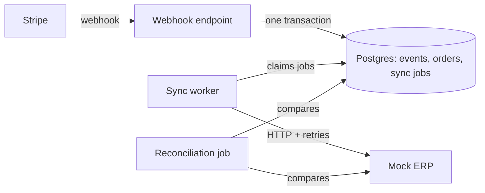

# LedgerSync


A small backend service that keeps Stripe payments and ERP accounting records in sync, and reports when they don't match.

Stripe sends webhooks for payments and refunds. Those get retried, the ERP is sometimes down, and refunds get missed, so the two systems drift apart. LedgerSync records each Stripe event exactly once, pushes it to the ERP with retries, and runs a reconciliation job that lists any mismatches.

**Stack:** Java 21, Spring Boot 3.5, PostgreSQL 16, Flyway, Stripe Java SDK, Testcontainers, Docker Compose, GitHub Actions

## How it works



1. `POST /webhooks/stripe` checks the Stripe signature, then saves the event, the order change and a sync job in one transaction. If the event id was already seen, it does nothing.
2. A background worker picks up pending jobs and sends them to the ERP. Failed calls are retried with exponential backoff. After 5 failures the job is marked `FAILED` and can be retried manually.
3. A reconciliation job (daily, or on demand) compares orders with ERP records and saves any issues it finds.

The ERP is a mock that lives inside the app under `/mock-erp`. Its failure rate and latency can be changed while it runs. The worker still calls it over HTTP like a real external API.

## Running it

You need Docker.

```bash
docker compose up --build
curl localhost:8080/actuator/health
```

Then run the load simulator (plain Python, no installs needed):

```bash
python3 scripts/simulate.py
```

It sends 500 orders with duplicate deliveries, refunds that arrive before their payment, and a 30% ERP failure rate, then prints a report. A run with 1,000 orders:

```
Webhook deliveries sent      2212
Duplicates rejected           845 / 845
Orders created               1000 / 1000
Refunds recorded              294 / 294
Failed ERP calls retried      778
Reconciliation issues after     0
Final consistency            100%
```

To test with real Stripe in test mode:

```bash
cp .env.example .env
stripe listen --forward-to localhost:8080/webhooks/stripe   # copy the whsec_... secret into .env
docker compose up --build
stripe trigger payment_intent.succeeded
```

To run the app outside Docker (needs Java 21):

```bash
docker compose up -d postgres
./mvnw spring-boot:run
./mvnw verify   # runs the tests, needs Docker
```

## API

| Method | Path | Description |
|---|---|---|
| POST | `/webhooks/stripe` | Stripe webhook receiver |
| GET | `/orders/{id}` | Order and its sync jobs |
| GET | `/sync-jobs?status=FAILED` | Failed jobs |
| POST | `/sync-jobs/{id}/retry` | Retry a failed job |
| POST | `/reconciliation/runs` | Run reconciliation now |
| GET | `/reconciliation/runs/{id}` | Reconciliation report |
| GET | `/stats` | Counts of events, orders and jobs |
| PUT | `/mock-erp/config` | Set mock ERP failure rate / latency |

## Design notes

- **No duplicates.** `stripe_events.event_id` has a unique constraint and the insert uses `ON CONFLICT DO NOTHING`. If nothing was inserted, the event is a duplicate. Doing this in the database also covers two copies of the same event arriving at the same time.
- **Sync job saved with the order.** The event, the order and the sync job are written in one transaction, so a crash can't leave an order that never gets sent to the ERP.
- **Safe with multiple workers.** Jobs are claimed with `SELECT ... FOR UPDATE SKIP LOCKED`, so two workers never pick up the same job. The claim is committed before the ERP call, so no transaction stays open during network calls.
- **Retries are safe.** The ERP may get the same request twice (for example after a timeout). Invoices are unique per Stripe payment id, and refunds send the total refunded amount rather than a difference, so repeating a call doesn't change the result.
- **Refunds wait for the invoice.** A refund job isn't picked up until the order's invoice job has finished, so it doesn't waste retries on "invoice not found".
- **Events out of order.** If a refund arrives before its payment, the app returns 503 so Stripe sends it again later.

## Tests

`./mvnw verify` runs 49 tests. The integration tests use a real Postgres through Testcontainers. They cover duplicate and concurrent webhooks, bad signatures, retries until success or failure, two workers running at once, stuck job recovery, timeouts after the ERP already saved the data, and every reconciliation issue type.

## What I'd change at scale

- Use a queue (Kafka or SQS) instead of polling the database.
- Run reconciliation as a streamed SQL join instead of loading everything into memory.
- Add retention for old events and jobs.
- For a real ERP: auth, rate limiting and a circuit breaker.
